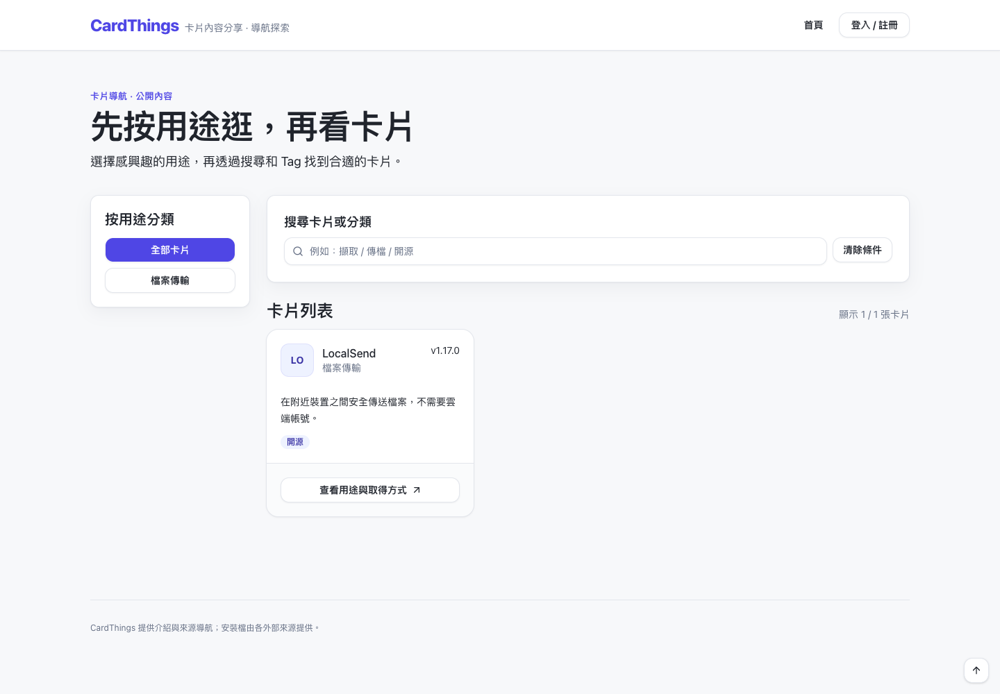

# CardThings

CardThings is a self-hosted catalogue for curated, link-based collections. Visitors browse public cards and dedicated detail pages; authenticated users manage their account; administrators manage cards, categories, tags, publication state, and external download sources.

CardThings stores descriptions and links, not installer binaries. Official and mirror files remain with their external providers.



## Features

- Public catalogue with text, category, and Tag discovery
- Published-only detail routes with version, installation, source, licence, episode, and download metadata
- Explicit official or mirror source labels; every download opens the external provider
- Real email/password registration, login, session, profile-name, and password management
- One shared login page with server-verified routing to the user or administrator workspace
- Unique usernames enforced by the database and checked during registration and profile updates
- Server-authorized administrator access and tool, category, and tag CRUD
- Draft and published tool states
- SQLite migrations, persistent Docker volumes, and documented backup/restore procedures
- Protected administrator overview, user listing, tool, category, tag, and profile pages

Favourites are intentionally deferred and are not shown in the current interface.

## Routes

- `/` — public catalogue, search, category filters, and tool cards
- `/tools/:slug` — published card details and external download sources
- `/auth` — shared login and registration; the server sends administrators to `/admin` and ordinary users to `/user`
- `/user` — authenticated account overview and profile security
- `/admin/login` — compatibility redirect to the shared `/auth` entry
- `/admin` — role-protected administration workspace

## Stack

- Next.js 16, React 19, and TypeScript
- Tailwind CSS 4 with selected shadcn/ui primitives
- SQLite with Drizzle ORM and committed migrations
- Better Auth email/password sessions
- Playwright and Vitest
- Docker Compose

## Local setup

Requires Node.js 22.12 or newer.

```bash
npm ci
cp .env.example .env.local
openssl rand -base64 32
```

Put the generated value in `BETTER_AUTH_SECRET` inside `.env.local`, then initialize the local development database:

```bash
npm run db:migrate -- --initialize
```

Use `--initialize` only for an intentional new database. Normal app startup and `npm run db:migrate` require an existing database and fail if its file or mount is missing. Check the configured path and recover the existing data before restarting an established installation.

Create the first administrator without saving a password in the repository or shell history:

```bash
export ADMIN_EMAIL="admin@example.test"
export ADMIN_NAME="Local administrator"
read -s ADMIN_PASSWORD
export ADMIN_PASSWORD
npm run admin:create
unset ADMIN_PASSWORD
```

Passwords must be at least 12 characters. No default administrator exists. Start the app at [http://127.0.0.1:3000](http://127.0.0.1:3000):

```bash
npm run dev
```

Production and development databases start without catalogue samples. Create categories, optional tags, cards, and external download links through `/admin`.

## Local demo accounts

The local preview uses the same [login page](http://127.0.0.1:3310/auth) for both roles:

| Login | Password | Role | Destination |
| --- | --- | --- | --- |
| `cardthings` | `password` | Ordinary user | `/user` |
| `cardthings_admin` | `password` | Administrator | `/admin` |

These are deliberately public local demo credentials. They are not created at startup. To create them in an existing local database:

```bash
npm run demo:create
```

The command requires `BETTER_AUTH_URL` to use a loopback address, stores hashed passwords, creates both accounts atomically, and refuses to change existing accounts. The aliases correspond to `cardthings@example.test` and `cardthings_admin@example.test`; either the alias or email works at login. Public registration and password changes still require at least 12 characters. Remove the demo accounts before exposing an installation publicly.

For a local Docker installation, use its existing data and uploads volumes:

```bash
docker compose --profile tools run --build --rm manager npm run demo:create
```

## Docker Compose

Copy `.env.example` to `.env`, replace `BETTER_AUTH_SECRET`, and set `BETTER_AUTH_URL` to the public origin before production use.

```bash
docker compose --profile tools run --rm manager npm run db:migrate -- --initialize
docker compose up --build -d app
```

The first command deliberately creates a new installation's database. For an existing installation, verify its configured volumes and database first, then start `app` without `--initialize`.

Create an administrator through the short-lived management container:

```bash
export ADMIN_EMAIL="admin@example.test"
read -s ADMIN_PASSWORD
export ADMIN_PASSWORD
docker compose --profile tools run --rm \
  -e ADMIN_EMAIL -e ADMIN_PASSWORD manager npm run admin:create
unset ADMIN_PASSWORD
```

The running app uses Next.js standalone output, so development and peer-only toolchains are absent from the runtime image. The separate `manager` profile contains the TypeScript tooling required for deliberate migration and account-management commands and does not run as a service.

See [Operations](docs/operations.md) for migration review, volume backup, restore, and environment separation.

## Verification

```bash
npm run lint
npm run typecheck
npm test
npm run test:e2e
npm run build
```

The end-to-end suite recreates only `data/e2e.sqlite*`. Its catalogue records and credentials live under test-only code and cannot be seeded into the development or production database through a package script.

## Data safety

- `data/`, `uploads/`, environment files, backups, and SQLite sidecar files are ignored by Git and Docker build context.
- Development, test, and production files use independent paths.
- No catalogue seed command or automatic default account exists; demo accounts require the explicit local-only command above.
- Every administrator mutation checks the server session and administrator role before writing.
- Migrations are generated as reviewable SQL and are never generated automatically at application startup.
